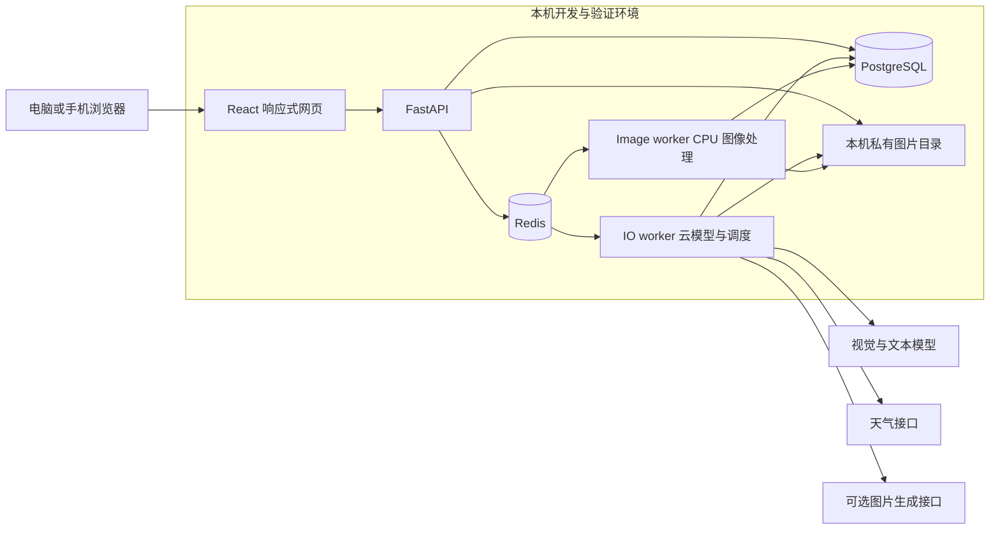

# IWardrobe 完整技术方案

版本：方案 v3，2026-10-13。当前验证环境：本机。后续部署目标：飞牛 OS NAS，无 GPU。交付范围：项目构成、模块接口、数据设计、实现流程、部署与验收；下文目录和代码片段描述目标设计。

实施更新：已建立 M0 基础工程和 M1 人工衣橱子集，提供独立账号、照片上传、私有存储、后台缩略图、编辑、洗衣/收纳状态、穿着次数及 4 张生成的演示样图。实际文件、启动方法与尚未实现的部分以 [README](../../README.md) 和 [本机验收记录](../validation/m0-local.md) 为准；不能将下文后续模块视为已完成。

IWardrobe 定位为多用户各自独立使用的衣橱工具：拍照建档，读取材质与洗标，管理衣物和洗涤状态，根据天气、场合与个人反馈提供可实际穿着的搭配。

采用独立项目、成熟依赖和模块化单体。前端为同时支持电脑、平板和手机的响应式静态网页，后端和后台任务共用同一 Python 包；模型推理以云服务为主。先完成真实衣物的建档和推荐，再加入生成式标准展示图。

## 1 设计依据和范围

已确定：每个用户独立、每日穿搭、衣橱管理、衣物/标签拍照、电脑和手机浏览器访问、飞牛 OS、无 GPU。所有业务数据以登录 user_id 归属，账户资料仅对应本人，没有家庭分组、独立穿着成员或代管关系。当前只推进本机搭建、功能实现和完整流程验证；NAS 基础配置、迁移与部署验收全部放到本机功能闭环之后，不作为任何本机功能阶段的前置条件。

本方案按独立 IWardrobe 工程组织。上一轮建议 Wardrowbe 作为候选基座仍适用于快速试用；本轮选择独立组织代码，是为了把用户隔离、属性来源、洗标审核和图片版本作为明确的数据契约。可以借鉴、在许可允许时复用上游实现，但不将多个应用的数据库、认证和页面直接拼接。

| 已调研项目 | 复用方式 | IWardrobe 自己负责的部分 |
| --- | --- | --- |
| [Wardrowbe](https://github.com/Anyesh/wardrowbe) | 学习衣橱、洗衣过滤、反馈推荐和异步任务流程；MIT 代码按模块评估 | 独立用户隔离、洗标结构化、字段审核、模块与数据契约 |
| [tandpfun/wardrobe](https://github.com/tandpfun/wardrobe) | 学习检测、裁剪、重建、人工审批的图像流程；MIT | 多照片资产关系、生成图真实性提示、云模型能力适配 |
| [Libre-Closet](https://github.com/Lazztech/Libre-Closet) | 学习修边、PWA 和轻量交互 | 默认独立实现；如直接引入 AGPL 代码须按其许可安排分发和源码义务 |
| rembg、Pillow、ONNX Runtime | 直接依赖，固定版本和模型 | CPU 任务隔离、质量回退、人工修边 |
| PaddleOCR | 在标签样本评估后引入轻量 CPU 模型 | 护理符号映射、字段来源与确认；普通 OCR 不代表能识别全部洗涤符号 |
| DeepSeek/OpenAI | 官方接口 adapter | 业务 schema、额度限制、失败处理及 credentials 隔离 |

首版包含独立账号、人工与 AI 建档、抠图、标签审核、衣物状态、天气、规则推荐、模型解释、穿着反馈、备份恢复。生成式正面图在主流程稳定后加入。虚拟试穿、购买推荐、社交分享、全套原生 App 和自训练大模型不进入首版。

## 2 技术基座与选择

| 基座 | 默认技术 | 选择理由及实施约束 |
| --- | --- | --- |
| 前端 | React、TypeScript、Vite | 响应式管理应用无 SEO 要求，构建为静态文件，NAS 无需常驻 Node 前端进程 |
| 界面与数据 | React Router、TanStack Query、Tailwind、shadcn/ui、React Hook Form/Zod | 路由、服务端状态、可访问表单分工明确；兼顾手机拍摄与电脑批量管理、并排审核 |
| PWA | vite-plugin-pwa/Workbox | 浏览器支持时可安装到手机或电脑；首版只缓存应用静态壳，私有 API 和照片不进入 Service Worker 缓存 |
| 后端 | Python 3.12、FastAPI、Pydantic 2 | Python 图像生态、结构化模型输出、OpenAPI 合约 |
| 持久化 | PostgreSQL 16、SQLAlchemy 2、Alembic | 用户数据、事务、作业记录和推荐快照统一保存 |
| 队列 | Redis 7、arq | 复用成熟任务执行机制；Postgres jobs 保存权威状态，Redis 负责派发 |
| 图像处理 | Pillow、pillow-heif、rembg、ONNX Runtime CPU | HEIC/旋转/缩略图/分割；目标架构 wheel 和模型运行能力须通过构建烟测 |
| 标签识别 | 首版云 VLM；可选 PaddleOCR CPU | 先打通识别审核，再按真实标签效果决定是否常驻 OCR |
| 模型 | DeepSeek API 首个 adapter；OpenAI API 第二个 | 接口分别覆盖视觉、推荐文本和图片生成；能力不作等价假设 |
| 天气 | Open-Meteo | 逐时体感温度、风雨和时区；数据库快照、内存短缓存 |
| 入口与部署 | Caddy、Docker Compose | 同源 HTTPS、静态网页和 API 转发；只暴露入口端口 |
| 依赖与测试 | pnpm、uv；Vitest、pytest、Playwright | 锁文件、真实 Postgres 集成测试和电脑/手机关键流程 E2E |

Python/Postgres/Redis 的大版本是工程起点，不是“最新版本”承诺。建工程时以依赖兼容、目标架构和 CI 验证为准，先锁定依赖版本，发布阶段再固定生产镜像 digest。GPU 依赖不进入默认镜像。

### 2.1 当前本机运行结构



数据库和图片先保存在本机；云端识别会发送所选照片，推荐默认只发送已确认属性。前端不保存模型 Key，不直接调用模型服务。开发时可由 Vite 代理 API，数据库和 Redis 使用本机 Linux 容器；不需要 NAS 地址、卷权限、证书或远程访问配置。

完整容器打包和 Caddy 正式入口放在本机闭环后的发布准备阶段。后端与 worker 共用一个 Python 项目，后续可以把同一套代码和数据迁移到 NAS。

## 3 计划中的项目文件构成

下列为逐阶段建立的目标目录；NAS 部署文件、生产 Dockerfile 和标注后续增强的功能，在对应阶段再创建，不作为本机首轮交付物。

```text
IWardrobe/
├─ README.md                         # 本地运行、部署、开发入口
├─ .gitignore                        # 排除真实照片、凭据、数据卷
├─ .env.example                      # 变量名称和非敏感示例
├─ pnpm-workspace.yaml
├─ pnpm-lock.yaml
├─ apps/
│  └─ web/
│     ├─ package.json
│     ├─ vite.config.ts
│     ├─ index.html
│     └─ src/
│        ├─ main.tsx
│        ├─ app/                     # router、响应式布局、query client、session
│        ├─ pages/                   # login、today、wardrobe、capture、review、settings
│        ├─ features/
│        │  ├─ identity/             # 登录、本人资料、退出与账号隔离
│        │  ├─ wardrobe/             # 列表、详情、编辑、洗衣和储物位置
│        │  ├─ capture/              # 多照片上传、旋转裁剪、任务进度
│        │  ├─ review/               # 原图对照、字段确认、冲突处理
│        │  └─ outfits/              # 推荐卡、理由、穿着记录与反馈
│        ├─ components/ui/           # 可复用基础控件
│        ├─ lib/api/                 # generated types/client、统一错误处理
│        ├─ styles/
│        └─ sw.ts                    # 缓存白名单、更新提示
├─ backend/
│  ├─ pyproject.toml
│  ├─ uv.lock
│  ├─ alembic.ini
│  ├─ migrations/                    # 数据库迁移与初始化词表
│  ├─ src/iwardrobe/
│  │  ├─ main.py                     # FastAPI 组装；不写业务流程
│  │  ├─ config.py                   # Pydantic Settings、配置校验
│  │  ├─ cli.py                      # 运维创建账号、密码恢复，不提供全用户衣橱入口
│  │  ├─ api/
│  │  │  ├─ router.py
│  │  │  ├─ dependencies.py          # Session、Actor、授权上下文
│  │  │  ├─ errors.py                # 稳定错误码到 HTTP 映射
│  │  │  └─ routes/                  # identity、garments、assets、jobs、outfits
│  │  ├─ modules/
│  │  │  ├─ identity/                # use_cases、policy、models、schemas、sessions
│  │  │  ├─ wardrobe/                # 衣物、状态、确认值、实际穿着
│  │  │  ├─ media/                   # 文件、派生图、掩膜、图片读取授权
│  │  │  │  └─ transforms/           # normalize、thumbnail、segment、mask
│  │  │  ├─ ingestion/               # 照片分析、候选属性、审核、重分析
│  │  │  ├─ recommendations/         # 候选、评分、终校验、反馈统计
│  │  │  │  ├─ candidates.py
│  │  │  │  ├─ scoring.py
│  │  │  │  ├─ validation.py
│  │  │  │  └─ learning.py
│  │  │  ├─ weather/                 # 预报、快照、时区、缓存与降级
│  │  │  ├─ inference/
│  │  │  │  ├─ contracts.py          # 类型化请求/响应、能力、错误
│  │  │  │  ├─ router.py             # 按任务类型选择 adapter
│  │  │  │  ├─ usage.py              # 预算与用量
│  │  │  │  ├─ adapters/             # deepseek、openai；SIWC 在 后续增强 加入
│  │  │  │  └─ prompts/              # tag、care_label、rank_outfits 的版本化模板
│  │  │  └─ jobs/                    # 提交、派发、lease、重试、取消和查询
│  │  ├─ workers/
│  │  │  ├─ io_worker.py             # 云调用、天气、每日推荐、补派发调度
│  │  │  ├─ image_worker.py          # CPU 任务的进程执行入口
│  │  │  └─ handlers.py              # job kind 到业务 Interface 的映射
│  │  └─ infrastructure/
│  │     ├─ db.py                    # engine、session、事务生命周期
│  │     ├─ logging.py               # request_id、job_id、脱敏
│  │     └─ clock.py                 # 时区/测试时间注入
│  └─ tests/
│     ├─ unit/                      # 候选、评分、字段合并、状态规则
│     ├─ integration/               # 真实 Postgres、授权、任务与文件一致性
│     ├─ contracts/                 # provider schema、限流/超时 fixtures
│     └─ fixtures/                  # 获准使用的少量测试图片，不放用户私有照片
├─ tests/e2e/                       # Playwright 电脑/手机录入、审核、推荐、登录隔离
├─ config/
│  ├─ defaults.yaml                # 默认参数及取值说明
│  ├─ taxonomy.yaml                # 类别、颜色、材质、护理动作词表
│  └─ recommendation_rules.yaml    # 场合、温区、套装模板、初始权重
├─ deploy/
│  ├─ compose.yaml                 # 本机依赖与后续部署的服务定义
│  ├─ compose.dev.yaml             # 本机热更新、仅回环地址调试端口
│  ├─ compose.nas.yaml             # 后续 NAS 阶段：持久卷、资源限制、HTTPS
│  ├─ Caddyfile
│  ├─ web.Dockerfile               # 多阶段构建静态站点并打包 Caddy
│  ├─ backend.Dockerfile           # API 与 IO worker 镜像
│  └─ image-worker.Dockerfile      # ONNX/图像依赖独立镜像
├─ scripts/
│  ├─ export-openapi.py            # 从后端导出前端契约
│  ├─ backup.sh                    # NAS 上一致性备份
│  ├─ restore.sh                   # 维护模式恢复和校验
│  └─ smoke-test.py                # 部署后登录、上传、任务、推荐烟测
├─ docs/
│  ├─ architecture/technical-design.md
│  ├─ research/                    # 已有仓库和模型调研
│  ├─ operations/                  # 部署、升级、恢复和故障处理
│  └─ validation/                  # 当前记录本机验收；NAS 记录在部署阶段增加
└─ .github/workflows/ci.yml        # 检查、测试、构建；发布需另行配置
```

模块内按实际需要建立 `models.py`、`schemas.py`、`use_cases.py`。同一模块可以内部拆分文件，外部通过少数业务 Interface 调用，避免 API route、worker 和模型 adapter 各自实现一份业务规则。

前端类型由 FastAPI OpenAPI 生成；业务校验仍由后端 Pydantic 执行，前端 Zod 只补表单交互。模型 prompt 和推荐规则均有版本号，便于解释旧结果与重跑。

## 4 模块职责与业务 Interface

| Module | 对外 Interface 示例 | 隐藏的 Implementation |
| --- | --- | --- |
| Identity | `get_actor(session)`、`require_owner(actor, resource)`、`update_my_profile(...)` | 会话、账号状态、数据归属和越权处理 |
| Wardrobe | `create_garment(...)`、`revise_garment(..., expected_version)`、`record_wear(...)` | 状态规则、字段确认、版本、穿着计数和推荐失效 |
| Media | `store_upload(...)`、`derive_asset(...)`、`read_asset(actor, id)` | 校验、临时文件、规范化、hash、目录、转换和私有读取 |
| Ingestion | `analyze_garment(...)`、`review_analysis(..., field_decisions)` | 图片选择、OCR/VLM、候选字段、冲突及证据 |
| Recommendations | `recommend(actor, context)`、`choose_outfit(...)`、`record_feedback(...)` | 候选、天气快照、排序、LLM 重排、终校验、个人统计 |
| Weather | `forecast(location, interval)` | 外部天气协议、缓存、时区、过期及不可用结果 |
| Inference | `analyze_images(...)`、`rank_outfits(...)`、`generate_display(...)` | provider adapter、能力差异、schema、超时、预算、用量 |
| Jobs | `submit(kind, target, input_version)`、`cancel(id)`、`retry(id)`、`status(id)` | 幂等、Postgres 状态、Redis 派发、lease、执行和重试 |

Interface 包含权限、版本、失败结果和执行方式，不能只列函数名。慢操作返回 job_id；任务查询返回状态与可理解的下一步。API 和 worker 共享这些 Interface。外部网络调用和 CPU 推理不持有数据库事务。

Adapter 优先放在真正会变化的位置：模型供应商和图像处理策略。首版图片落盘直接使用本地实现；未来确有对象存储需求再引入第二个存储 adapter。首版不引入独立向量库。

## 5 独立账号与用户隔离

### 5.1 核心概念

User 是唯一业务归属。每个登录账号拥有自己的衣物、图片、属性审核、天气地点、偏好、推荐、穿着记录、任务、预算和模型连接。user_profiles 与 users 一对一，只存本人时区和偏好配置，不代表可被另一个账号代管的穿着对象。

Garment 是属于一个 User 的实物单品，两件同款仍有不同 garment_id。首版不提供跨账号借衣、分享、代管或切换他人衣橱。

### 5.2 授权规则

普通业务入口使用当前登录账号，不接受请求体或 URL 中的 user_id 作为授权依据。按资源 ID 访问时，数据库查询同时约束真实 user_id；图片、任务、识别结果、推荐、统计和导出都执行相同检查。

系统维护只负责创建/停用账号、部署、备份和恢复，不自动获得浏览所有用户衣橱的业务入口。NAS 运维者在操作系统层面可接触数据库与文件，这与应用内的用户隔离是不同层次。

模型凭据和预算默认逐用户配置。一个账号不能读取、选择或消耗另一账号的模型连接；缓存、图片去重和任务幂等同样按账号隔离。

### 5.3 登录与账号生命周期

采用本地账号、Argon2id 密码哈希、Postgres opaque session。Cookie 使用 HttpOnly、Secure、SameSite=Lax；正式访问使用 HTTPS 同源。数据库只保存随机 session token 的 hash、过期时间和撤销状态。退出、改密码、停用账号时按策略撤销会话。

首版通过部署端 CLI 创建账号和恢复密码，不开放公开注册，也不设置家庭初始化/加入流程。每个账号首次登录只填写本人所在地、时区及初始偏好。后续如需要自助注册再增加独立注册策略。

修改请求验证 Origin 与 CSRF token；登录有按账号/IP 的限制和失败退避。停用账号会阻止后续后台云调用和结果发布，但不会立即物理删除衣橱。永久删除需要清晰的数据与备份保留策略。

应用登录和 AI 供应商 OAuth 分别认证；取得模型授权不赋予访问其他用户衣橱的权限。OIDC 可以后续增加，业务仍以本地 user_id 为归属。

## 6 数据模型

所有时间存 UTC；展示和每日任务使用当前用户设置的 IANA 时区，默认 Asia/Shanghai。ID 使用随机 UUID。所有用户业务表带 user_id；通过 (user_id,id) 复合唯一键及相应外键保证衣物、图片、推荐和任务的归属一致，业务 policy 负责读写授权。

### 6.1 表与主要字段

| 表或表组 | 主要字段 | 关键约束 |
| --- | --- | --- |
| users、sessions | email/username、password_hash；token_hash、expires_at、revoked_at | 登录名唯一；session 可撤销 |
| user_profiles | user_id、display_name、timezone、default_location、inventory_revision、preferences_version | 与 users 一对一；资料和偏好仅本人访问 |
| garments | user_id、name、category、size、fit_status、colors、pattern、warmth_level、formality、catalog_status、availability、version、deleted_at | fit_status 为 fits/does_not_fit/unknown；实物有独立 ID；更新 version |
| assets | user_id、kind、storage_key、mime、sha256、dimensions、parent_asset_id、transform_version、state | storage_key 由后端生成；原图不可覆写 |
| garment_assets | garment_id、asset_id、role、is_primary | 限同一 user_id；每件衣物每角色最多一个当前主图 |
| analysis_runs | garment_id、input_asset_ids、input_revision、provider、model、prompt_version、status | 对输入快照分析，不直接替换确认值 |
| attribute_suggestions | analysis_id、field_path、value、source、evidence_asset_id、evidence_region、review_status | 候选按字段审核；保留拒绝原因和冲突 |
| garment_care | garment_id、fiber_composition、care_actions、raw_label_text、confirmed_at | 成分可未知/不完整；动作含温度、强度、禁止等限定 |
| wear_events、wear_event_items | user_id、local_date、event_timezone、occurred_at、outfit_id 可空、garment_id、item_snapshot | 幂等键防重复记录；同日可换装；撤销保留关联 |
| feedback_events、preference_profiles | user_id、run/outfit 引用、维度、取值、supersedes_id；聚合偏好 | 事件是事实来源；聚合结果可重算 |
| weather_snapshots | location_key、provider、fetched_at、valid_interval、hourly_payload | 同次推荐使用同份预报；标明过期状态 |
| recommendation_runs | user_id、date、context、input_signature、weather_id、rules_version、status、mode | 关联衣橱版本、偏好版本；区分正常/降级/无解 |
| outfits、outfit_items | run_id、score_breakdown、reasons；garment_id、garment_version、slot、item_snapshot | snapshot 保存当时名称/属性/图片引用；不能由模型创建衣物 |
| outfit_plans | user_id、outfit_id、date、wear_window、status、version | 计划与实际穿着分开；每天可有多时段；定时生成不能覆盖人工计划 |
| recommendation_schedules | id、user_id、enabled、timezone、local_time、wear_window、location、occasion、revision、next_run_at | 每用户独立；自动调用所用账号和配置可追溯 |
| jobs | user_id、provider_connection_id、kind、target_id、input_revision、run_generation、status、attempt、dispatch_sequence、lease_version、lease_until、next_attempt_at、error_code、retryable | Postgres 权威状态；同一有效业务任务去重 |
| provider_connections | user_id、provider、auth_kind、secret_ref、status、capabilities_checked_at | 按用户独立配置；只能调用本人的连接；不返回 secret |
| provider_credentials 后续增强 | connection_id、encrypted_payload、credential_version、expires_at | 仅订阅/OAuth 接入阶段加入；主密钥独立保存 |
| model_usage | job/run_id、provider、model、tokens/images、estimated_cost、actual_cost 可空 | 模型报告值和估算分开；不存凭据 |
| audit_events | actor、action、target、created_at、request_id | 记录权限变更、删除、生成调用等重要操作 |

User 的主观偏好放 preference_profiles；物品属性放 garments/care，避免“某位用户觉得热”修改衣服本身保暖字段。衣物的可索引高频属性用类型化列，长尾识别结果和证据用 JSONB；不采用全字段 EAV。

所有影响候选的衣物创建、修改、状态变化及删除，在同一事务中递增 User 的 inventory_revision；反馈或人工偏好更新递增 preferences_version，实际穿着或撤销也使轮换评分的输入修订失效。必须激活的最小字段为所属用户、名称、类别和明确的库存状态，尺码未知不会阻止人工建档。

### 6.2 字段来源与确认

每个已确认属性保存 `source: manual | label | vision`、`confirmed_by`、`confirmed_at` 和原证据引用，可在 garments 的 `attribute_provenance` JSONB 中按 field_path 保存。模型重跑只新增 suggestions，不直接改 confirmed 值。冲突在审核页显示“原值、候选、证据”；用户逐项决定。

材料字段示例：

```json
{
  "fiber_composition": [
    {
      "part": "shell",
      "components": [
        {"fiber": "cotton", "percent": 80},
        {"fiber": "polyester", "percent": 20}
      ],
      "complete": true
    }
  ],
  "care_actions": [
    {"action": "wash", "method": "machine", "max_temperature_c": 30},
    {"action": "bleach", "allowed": false},
    {"action": "tumble_dry", "allowed": null}
  ],
  "source": "label",
  "review_status": "pending"
}
```

未识别到烘干符号时 `allowed=null`，不能推导为允许。成分按面料、里料、填充物等部位分组；只有某部位完整百分比标注才校验该组的合计及容差，不能把面料与里料相加。标签缺失不强迫补齐 100%。模型 confidence 只是待审核线索，不作为校准后的正确概率。

### 6.3 状态分开建模

| 对象 | 状态 | 含义 |
| --- | --- | --- |
| garment.catalog_status | draft / active / archived | 资料是否可用于日常业务 |
| garment.availability | available / needs_wash / washing / stored / unavailable | 实物是否可穿 |
| asset.state | staging / ready / failed / deleted | 文件是否完整、可访问 |
| job.status | queued / running / retry_wait / succeeded / failed / cancelled | 一次后台处理生命周期 |
| suggestion.review_status | pending / accepted / rejected / superseded | 识别字段审核情况 |
| recommendation.status | pending / ready / degraded / no_solution / stale / failed | 推荐结果的可用程度 |

AI 失败不会把衣物永久卡在“处理中”。用户手填必填项后可将 draft 激活。补拍和重分析不自动改变已经 active 的衣物。

## 7 照片到衣物档案的实现

### 7.1 手机拍照与电脑上传

手机引导“一次一件衣物”，同件衣物可有正面、背面、材质标、护理标等多张图。电脑支持拖拽或批量选择照片，按衣物分组并确认用途，使用同一上传接口。穿着照允许手动裁剪目标；多衣物自动检测作为 后续增强，检测结果须经用户确认，每件衣物建立独立记录。

上传流程：创建 draft garment，按照片逐个上传，前端为每个操作保存 Idempotency-Key。网络失败只重传失败照片；首版不做分块断点续传。上传前可提示过大图片和格式问题，但完整原图是否上传由实际限制和用户选择决定。

后端按流写入 staging 目录，同时计算 hash，检查字节数和文件魔数。文件完整落盘后在同一文件系统原子移动到私有原图目录，随后同一数据库事务建立 state=staging 的 asset、衣物关联与验证 job，返回 202 和 asset_id/job_id。图像 worker 完成解码、像素限制、方向规范化和预览后才将原资产标记 ready，失败则 failed；未经验证的文件不能通过图片接口展示或送往云模型。验证成功后在提交事务内创建后续处理 job，无须引入通用工作流引擎。

文件系统与数据库之间没有原子事务，定期清理超时上传临时文件和未被引用的孤儿文件；ready 引用必须指向完整、已验证文件。Idempotency-Key 按操作者、目标衣物和操作隔离；同 key 不同内容返回冲突。客户端响应丢失后可按上传标识查询已有结果，再决定重传，避免同一照片产生多份关联。

初始可配置限制：单图 25 MiB、50 MP，标准分析图长边 1600 px，标签识别优先保留独立清晰裁剪。它们是控制资源的起点，要用手机真实样本调整。原始文件保留 EXIF 供追溯，派生图剥离 GPS 等元信息；显示前规范方向和 sRGB。

### 7.2 本地图像处理

image worker 在受限子进程中执行规范化、缩略图、分割和用户掩膜合成；默认并发 1，避免重推理阻塞任务心跳。rembg 初始显式选择 u2net，若资源不足再对比 u2netp；BiRefNet lite 经实测后可切换。模型下载到独立可持久化目录，记录名称、版本和校验和。

抠图输出 PNG/WebP 透明图；保留原始比例，以 padding 统一画布，不拉伸到固定宽高。平铺照片可做有限透视校正；穿着照的遮挡和三维褶皱不能通过透视变换真实还原。失败时展示规范化原图并允许裁剪、修边、重拍，衣橱功能可继续使用。

手动修边保存与规范化源图同尺寸、同坐标系的 mask，并记录 source asset/version。重跑分割生成新派生图，用户选择哪一版作为主图，后台不会覆盖用户已修正的结果。

### 7.3 识别与审核

ingestion 从 ready 资产生成不可变输入清单：衣物照片用于类别、颜色和风格；标签照片用于实际材质和护理。先调用视觉 adapter 获取结构化建议。PaddleOCR 可作为可选文字证据来源；模型解释和文字识别发生冲突时呈现原图，禁止静默选择更自信的一方。

结果经 Pydantic 校验、词表归一化、合理值约束后进入 suggestions。模型补充仅限可解释属性；衣物外观不用于断言真实纤维比例。护理禁忌、百分比及温度均保留证据片段。

审核页显示衣物/标签原图和候选字段，支持全部确认后逐项修改。提交包含 expected_garment_version；如果另一位管理者已修改同件衣物，返回 409 和冲突字段，不覆盖最新内容。

重复照片 hash 只用于当前用户范围内提醒，不能自动合并实物：同一用户可能有两件相同 T 恤。自动去重不能返回其他用户是否拥有相同照片的信息。

### 7.4 生成式正面展示图 后续增强

单独设置“生成展示图”操作：明确选择源图、目标服装和重建请求，创建收费能力对应的 job。生成图作为 generated_display asset，记录父资产、模型、prompt_version，等待用户对照确认。纹理、纽扣、衣长可能被改写；原图和真实 cutout 继续保留。

这条流程调用 image-generation adapter，不与 vision adapter 混用。DeepSeek 视觉或 SIWC 图片输入不自动提供图片生成能力。暂不把生成展示图作为颜色提取、OCR 或真实性数据源。

## 8 天气与每日推荐的实现

### 8.1 预测上下文

用户选择日期、地点、出门时段、场合和活动强度，身份直接来自登录态，默认值从本人设置读取。地点只需城市级坐标，不强制读取 GPS。Open-Meteo 请求逐时体感温度、降雨概率/量、风和温差，保存完整所用快照与 fetched_at。[官方文档](https://open-meteo.com/en/docs)

穿着时段转换为明确的 UTC 起止时间，支持跨午夜；不要通过“当地日期加固定 24 小时”处理所有时区。天气和规则展示真实预测值，个人怕冷/怕热修正只影响内部评分。

同地点天气缓存初始 60 分钟。网络失败可使用 6 小时内且仍覆盖目标时段的快照并标明过期；超过阈值或不覆盖时段，返回 weather_unavailable，允许用户手工选择冷/温和/热等条件。具体 TTL 是可调参数，不是天气准确性的保证。

### 8.2 候选过滤和套装模板

先按当前登录 User 过滤本人衣物，再筛选 active、未删除、available，排除 fit_status=does_not_fit 及明确禁用项。fit_status=unknown 可进入候选但提示尚未确认，不能等同不合身；用户启用“只推荐确认合身的衣物”时才硬过滤 unknown。缺失材质、颜色等信息不能伪造成已知值；关键约束未知时标注缺失并让用户补充。严寒/暴雨等无法满足的必要条件应返回缺少的物品或警示，不能给出“适合天气”的确定结论。

套装模板初版为：上装＋下装＋鞋；连衣裙/连体服＋鞋；可选外套及配饰。套装不能同时把连衣裙和裤装当必需槽位，也不能重复引用同一 garment_id。用户明确未录入鞋时，可返回“需补充鞋”的不完整方案，UI 不能把它标成完整搭配。

按槽位先保留最多 12 个候选，用 beam search 保留最多 40 个部分组合，再得到最多 120 个合法整套候选。按可配置权重排序并选择有差异的三套；有限衣橱不足三套时如实返回实际数量，不通过换顺序凑三套。候选上限是首版资源控制参数。

### 8.3 可解释评分

每个分量归一化到 0 到 1，初始规则为：

```text
score = 0.30 * weather_fit
      + 0.25 * occasion_fit
      + 0.20 * preference_fit
      + 0.15 * color_harmony
      + 0.10 * rotation_fit
```

这是待用户反馈校正的启发式权重。weather_fit 依据温区、分层模板、可选 warmth_level 和体感反馈；不把衣服暖度简单相加后宣称为真实 clo/热舒适测量。occasion_fit 依据用户给定场合和单品正式程度；color_harmony 先用中性色、同色系及可配置配色表，照片光照导致的色差可以人工修正。rotation_fit 降低近期重复但不压过天气适用性。

规则文件的初始温区可设 `<8°C、8–16°C、16–22°C、22–28°C、≥28°C`，分别映射寒冷、偏凉、温和、偏暖、炎热的分层模板，按左闭右开处理中间区间。怕冷/怕热的初始评分修正可设 -3°C/+3°C，后续用冷暖反馈有界调整。这些都是启发式默认值，不表示对应温度下某件衣服一定舒适。

未知评分属性默认取中性 0.5，并显示证据不足；weather_fit 分别考虑上身、下肢和鞋，避免用一件厚外套弥补所有部位的缺失。保留触发规则与分项分数，便于用户理解和调参。

偏好冷启动询问常穿风格、喜欢/不喜欢的颜色、宽松程度、冷暖倾向、常见场合。用户未填时使用中性默认规则，展示可修改理由。体感调整和风格偏好分开记录；不同账号不共享同一偏好统计。

### 8.4 模型重排与终校验

把最多 12 套完整候选的 outfit_candidate_id、真实衣物属性、天气摘要和偏好交给文本 adapter。模型只返回候选编号顺序、解释和小幅调整建议，不能构造新的 garment_id。这样保留时尚语言和上下文判断，同时让代码控制可穿性。

先完成并保存本地规则结果，再尝试云增强。结果必须再次校验候选编号、权限、衣物 version、状态、槽位、重复和天气约束；解释中不允许补造未给出的材质/品牌/护理属性。模型返回无效 JSON 或编号时至多做一次受预算约束的纠正；云未配置、超预算、401/403、限流或超时也一律保留规则结果，返回 degraded、mode=rules_only 和原因。待配置只影响云增强步骤，不能让整个推荐被阻塞。

推荐创建时保存衣橱、偏好、规则、天气及模型版本。确认“今天穿这套”时再查当前衣物状态和归属；如果期间被标记待洗、归档或删除，返回 stale 并提示替换。item_snapshot 保存当时名称、类别、颜色、相关确认属性及 asset_id，浏览历史按推荐原 User 授权，不通过旧记录获得当前其他用户衣物的访问权。

默认软删除保留有效历史快照引用的图片；清理器只有在没有衣物、历史、派生等有效引用时才回收。用户明确要求彻底删除图片时同时清除历史图片引用并保留文字占位，备份中的到期删除遵循备份保留策略，界面说明区别。

### 8.5 穿着反馈

区分看过、收藏、选择、实际穿着、满意度和冷暖反馈。实际穿着才增加 wear_count 和 last_worn；浏览或喜欢不能直接触发洗衣状态。记录穿着时可一并标记需要清洗，按类别的洗涤间隔作为可调整提醒，不自动认定所有衣物每次都必须洗。

以事件形式保存反馈，撤销/修改通过引用原事件实现；聚合偏好可从有效事件重建。初期使用平滑统计和有界增减，不训练大模型。用户明确的禁用偏好优先于学习结果；单次差评不能永久排除某颜色。

初始统计可采用 `learned_preference = Σ(decay × weight × signal) / (5 + Σ(decay × weight))`，其中评分信号为 `(rating - 3) / 2`、`decay = 2^(-age_days/90)`；显式评价权重 1，没有评分的实际穿着可暂用 weight=1、signal=0.2 作弱正反馈。同一次穿着的最终评分替代旧评分或弱穿着贡献，不重复叠加。冷暖反馈只调整个人温区偏好，“衣物不可用”只影响状态；两者不直接记为讨厌该颜色或风格。参数是首版初值，可根据试用结果修改。

### 8.6 定时生成与缓存

默认按每个 User 的时区在早晨设置时间预生成，可关闭或修改。scheduler 每分钟检查到期任务，使用 `(schedule_id,target_local_date)` 唯一业务键防重复，配置 revision 作为输入版本，不因当天修改时间自动重复生成；用户明确“重新生成”才创建新 generation。日期以目标用户时区计算。任务检查当前用户权限和天气；云能力不可用按 rules_only 处理。

初始生成时间为当地 07:00、穿着窗口 08:00 至 20:00，仅作默认值。计划保存在 outfit_plans，点击“准备穿”不等于“实际穿了”；重新生成只增加推荐批次，不能覆盖已经手工选定的计划。账号停用时暂停该用户全部定时任务及结果发布；账号有效但模型授权撤销时只跳过云增强，保留规则推荐并在本人设置中显示原因。

缓存 key 包含 user_id、当地日期、IANA 时区、UTC 穿着窗口、地点、场合、衣橱修订、偏好修订、规则版本、天气快照或手工天气上下文。衣物状态变化立即使新请求使用新签名；已有推荐标记 stale。运行主机关机期间错过的任务，在恢复后只补当天仍有意义的时段，不补发所有历史日期。

## 9 云模型接口和费用控制

### 9.1 按能力分开配置

```yaml
ai:
  vision:
    provider: deepseek
    model: deepseek-flash
  stylist:
    provider: deepseek
    model: deepseek-flash
  image_generation:
    enabled: false
  subscription:
    enabled: false
```

模型名称是本次已核实文档的示例，实际启用时检查该账号的可用模型。基础接口包括请求类型、结构化输出 schema、输入资产/候选、超时和预算；输出包括结果、usage、provider_request_id、model_version 和稳定错误码。

adapter 对外声明实际能力，如 image_input、structured_output、image_generation、streaming；调用方不能因 endpoint 看起来 OpenAI-compatible 就发送全部相同参数。业务层接收解析后的领域结果，不依赖某厂商原始响应结构。

provider_connections 保存所属 user_id 和 secret_ref。首版标准 API Key 使用按用户隔离的后端受保护 secret 文件，通过部署端 CLI 配置映射；前端只能看到本人的配置状态，不回显密钥。后续增强 OAuth 凭据加密后存 provider_credentials，主密钥独立于数据库和镜像保存，另作加密备份；refresh 按连接串行并使用 credential_version 防止旧值覆盖新值。缺失主密钥时不能恢复密文，旧备份里的 refresh token 也可能已经轮换，需要重新授权。

### 9.2 DeepSeek、OpenAI 与订阅

[DeepSeek 当前视觉文档](https://api-docs.deepseek.com/zh-cn/guides/vision/) 支持 deepseek-flash 图片输入，可优先验证衣物和洗标提取。标准 OpenAI API 可作为另一 adapter，按独立 API 计费。

符合条件的 ChatGPT Plus/Pro 可研究 [SIWC](https://developers.openai.com/siwc/quickstart)；[自托管运行环境](https://developers.openai.com/siwc/token-sharing-open-source/self-hosted-vms) 的认证方式可用于设计个人 NAS 的验证方案。实际接入放 后续增强：凭据按授权账号和注册隔离、刷新串行化，令牌不进入跨用户共享配置。

[SIWC 当前限制](https://developers.openai.com/siwc/token-sharing-open-source/preview-limitations) 包含图片输入可用、图像生成不可用；不支持 Responses background 参数不等于 NAS 自己的队列不能定时调用。账号资格与当前能力须按每个授权用户验证，不把任意一个账号的订阅作为其他用户的默认调用凭据。

Codex CLI/SDK 可用于本人离线批处理试验；正式衣物流程不启动有任意文件/命令权限的 agent。更详细来源见 [模型接入笔记](../research/model-access.md)。

### 9.3 调用策略

图片识别只在新增或用户请求重分析时进行，正常每日推荐复用已确认属性。按输入 hash、模型、prompt 和 schema 版本判断是否已有可复用结果，复用范围限制在同一用户。

配置单次图片数、最大输入/输出、每日调用次数和可选费用预算。标准 API 成本按实际 usage 和人工维护的有效价格表估算；订阅记录请求/额度错误，不能套用 API 单价伪造实际账单。超预算返回待处理，不无限重试。

429/短暂网络失败按 Retry-After 或退避重试；401/403 记为 failed、error_code=AUTH_REQUIRED、retryable=false，界面显示待配置；结构错误最多一次纠正。外部请求超时可能已经计费，缺少 provider 幂等/查询能力时记为 failed、error_code=RESULT_UNKNOWN、retryable=false，生成图片不盲目自动重付费重试。修复配置或明确决定重新调用后，创建新 run_generation。预算统计必须把失败但可能已计费的尝试计入估算；推荐的云增强失败仍采用第 8.4 节回退。

原图是用户数据，不允许模型根据洗标中的文字执行指令或调用任意工具。标签 OCR、VLM 输出均按不可信数据解析，不能插入系统提示或 SQL。

## 10 后台任务与恢复

### 10.1 提交和派发

创建业务记录和 jobs 在同一 Postgres 事务提交。事务结束后尽快派发 Redis；派发失败保留 queued。一个 dispatcher 在 IO worker 中定期扫描到期 job 并补派发，不另建通用事件总线。

业务幂等键由 kind、target_id、input_revision、明确的 run_generation 构成。Redis/arq 的 dispatch ID 包含独立 dispatch_sequence，避免旧 arq 结果挡住手动重试。重复队列消息不代表重复业务执行，worker 必须先在 Postgres 原子领取 lease。

### 10.2 执行和提交

job 领取时增加 lease_version、设置 lease_until。发送云请求前和发布结果前，重新检查任务所属 user_id 的账号状态，以及目标资源和模型连接是否仍属于该用户。普通退出登录不取消已经提交的后台工作；停用账号或撤销模型连接会阻止后续请求和结果发布。执行中异步心跳续租，CPU 任务放独立子进程。提交结果的事务必须同时满足 job 仍 running、lease_version 一致、目标未删除、输入修订仍符合策略。旧 worker 即使晚返回，也不能覆盖当前结果。

AI 分析对应旧图片或旧字段版本时可以保存为 superseded 供查看，不得自动应用到新版本衣物。取消是协作式的：阻止下一步骤和结果发布，无法保证已经发出的云请求不计费。

### 10.3 重试和重启

本地幂等处理可指数退避重试，初始最多 3 次；重试前检查错误类别。外部结果不确定时按第 9 节处理。lease 过期由恢复器处理，重新入队或标记需要人工确认。

Redis AOF 可减少丢失，但业务恢复依赖 Postgres jobs，不依赖 Redis 备份。运行主机或进程重启后恢复器检查 queued/retry_wait 和过期 lease，未完成步骤重新执行。文件派生使用临时路径和内容/版本标识，只有成功事务发布的资产才可被用户读取。

删除衣物先软删除、撤销相关任务发布资格；后台结果落库前再次校验。清理器在保留期后删除不再被有效资产引用的文件。若原始群图被多个派生衣物引用，必须等待全部引用失效，不能删除仍使用的原图。

## 11 HTTP 接口契约

统一前缀 `/api/v1`，浏览器同源 Cookie 认证。慢任务返回 `202 {job_id, status_url}`；读写成功使用稳定资源 schema。更新带 version 或 If-Match，冲突返回 409。列表使用 cursor 分页；错误返回 `{code, message, retryable, request_id, details}`。

| 方法与路径 | 实现目的 | 关键约束 |
| --- | --- | --- |
| POST /auth/login、/auth/logout | 创建/撤销 session | 登录限流；退出清 Cookie |
| GET/PATCH /me | 返回/修改本人资料和默认设置 | 身份来自 session；不返回模型 secret |
| GET/POST /me/garments | 本人衣橱列表/人工建档 | 服务端填充 user_id，不能指定其他用户 |
| GET/PATCH/DELETE /garments/{id} | 查看、编辑、软删除 | expected_version；批量同样逐项授权 |
| POST /garments/{id}/assets | multipart 上传照片 | 202；Idempotency-Key、角色、大小/格式限制 |
| GET /garments/{id}/uploads/{client_upload_id} | 响应丢失后的上传查询 | 与上传使用相同的授权和幂等范围 |
| GET /assets/{id}/content | 私有图像内容 | 重新授权；不公开宿主机文件路径 |
| POST /assets/{id}/derivations | 抠图、旋转、掩膜等 | 202；输入版本；转换参数校验 |
| POST /garments/{id}/analyses | 启动识别 | 202；选择 ready 资产与能力 |
| GET /analyses/{id} | 获取字段和证据 | 同用户权限 |
| POST /analyses/{id}/review | 接受/拒绝字段 | 衣物版本；不覆盖人工确认冲突 |
| GET /jobs/{id}；POST /jobs/{id}/retry、/cancel | 任务进度与控制 | 状态机及授权；取消语义明确 |
| POST /me/recommendations | 按日期/天气/场合推荐 | 202；受预算和幂等策略限制 |
| GET /recommendations/{id} | 查询结果与降级原因 | 历史快照、当前 stale 状态 |
| POST /me/wear-events | 手工记录实际穿着 | garment_ids、occurred_at、可空 outfit_id、Idempotency-Key |
| POST /outfits/{id}/wear-events | 套装确认实际穿着 | 委托同一用例；再校验版本和 availability |
| POST /wear-events/{id}/reversal | 撤销误记穿着 | 原子更新有效事件和聚合，保留审计 |
| POST /me/outfit-plans | 计划某时段穿着 | 校验当前套装；不增加 wear_count |
| GET/PUT /me/recommendation-schedule | 查询/修改每日任务 | 本人权限；时区和配置 revision |
| POST /me/feedback | 记录喜好或冷暖反馈 | 验证引用属于同 User |
| GET/PATCH /me/preferences | 初始与人工偏好 | 学习值与人工禁用项分开 |
| GET /health/live、/health/ready | 进程/依赖状态 | API ready 依赖 DB/存储；Redis 异常标记异步功能降级，不阻止人工 CRUD |

穿着事件写入和撤销在同一事务中更新有效计数/last_worn 和推荐输入修订。同一 key 重试只记录一次，一天换两套可使用不同事件；event_timezone 固定当时日期解释，后续修改用户时区不改历史日期。

首版前端轮询 job 状态，可见页面 2 秒起步、长任务逐步退避到 10 秒，离开页面停止轮询。无须为单向进度部署 WebSocket。进度只报告已完成步骤，不把未知耗时模型请求伪造为精确百分比。

## 12 电脑与手机前端

同一套 React 前端正式支持电脑、平板和手机，共用业务与 API，按屏幕宽度调整布局。手机优先满足拍摄和随手查看；电脑重点满足批量录入、并排审核、筛选和维护，两端均可完成所有核心业务。

| 终端 | 交互布局 | 必须验证 |
| --- | --- | --- |
| 手机 | 单列/紧凑网格、触摸操作、相机或相册入口 | 拍摄/选图、滚动、裁剪、审核、推荐及状态修改 |
| 平板 | 双列衣橱、适当展开详情 | 横竖屏切换和触摸目标 |
| 电脑 | 多列网格、侧栏筛选、图片与字段并排 | 拖拽与批量上传、鼠标修边、键盘操作、批量编辑 |

首版不需要 Electron 或独立原生 App。PWA 是浏览器应用的可安装能力；相机权限、安装方式和文件选择体验依浏览器而异。自动化先覆盖移动/桌面视口，再在真实手机上验证拍摄和上传，不把视口模拟当成手机硬件验证。


| 页面 | 用户主要操作 | 实现重点 |
| --- | --- | --- |
| 登录/本人初始化 | 登录账号、填写本人默认设置 | 区分应用登录和模型授权 |
| 今日穿搭 | 切换场合、时间，选本人方案 | 天气时间、真实衣物拼贴、理由、降级和缺失项 |
| 衣橱 | 搜索、筛选、标记洗衣、储物 | 状态可见；多选操作只作用明确选中项 |
| 衣物详情 | 原图/展示图、属性、标签和历史 | 生成图标签；字段来源；编辑不依赖 AI |
| 拍照录入 | 单件多照、角色分类、继续拍下一件 | 上传可重试；后台处理不阻塞连续录入 |
| 待审核 | 对照照片确认识别结果 | 字段差异与证据；低质量提示重拍 |
| 洗衣与收纳 | 待洗、洗涤中、可用、收纳 | 批量状态变更更新版本并使推荐失效 |
| 历史与偏好 | 记录实际穿着、冷暖、评分 | 允许撤销；解释推荐如何受偏好影响 |
| 设置 | 本人资料、地点、任务、模型状态 | secrets 只显示已配置状态，不回显完整值 |

PWA 的“安装到桌面”不等于全离线能力。首版离线显示网络状态和静态壳，恢复网络后取授权数据；退出登录清理前端 Query cache，浏览器返回键不能显示前一用户的私有数据。

## 13 后续 NAS 部署与文件存储

本节保留部署设计，全部在本机核心功能闭环后执行。当前不连接 NAS、不配置飞牛存储卷或远程入口，也不要求提前构建目标 NAS 架构镜像。本机阶段只使用可配置数据根目录、依赖锁文件和数据库迁移，避免将来搬迁时重写业务。

### 13.1 Compose 服务

| 服务 | 内容 | 持久化和访问 |
| --- | --- | --- |
| web | Caddy＋构建好的静态前端 | 证书和配置；唯一对外端口 80/443 |
| api | FastAPI | 私有资产目录读写；DB/Redis 在内部网络 |
| worker-io | arq IO 队列、scheduler、dispatcher | 云凭据和所需资产；初始一个实例 |
| worker-image | arq 图像队列＋CPU 子进程 | 资产和模型目录；初始并发 1 |
| postgres | 数据库 | 独立 db 数据卷，不发布外网端口 |
| redis | 调度队列 | AOF 可选持久化；可由 Postgres 状态恢复 |

迁移使用一次性 migrate 容器/命令，在应用写入前运行，不由每个副本抢着执行。API 和 worker 等待迁移完成以及依赖健康后启动。镜像设置非 root 用户，映射飞牛数据目录的实际 UID/GID；不把 NAS 管理目录或 Docker socket 挂入应用。

数据根目录由部署者选择，如 `/volX/.../iwardrobe`，不是固定飞牛路径。计划布局如下：

```text
<DATA_ROOT>/
├─ postgres/                 # 数据库卷或命名卷对应数据，不在线裸拷贝
├─ redis/                    # 可重建队列
├─ assets/
│  ├─ originals/<user>/<asset-id>.<ext>
│  ├─ normalized/<user>/<asset-id>.<ext>
│  ├─ derived/<user>/<asset-id>.<ext>
│  ├─ masks/<user>/<asset-id>.png
│  └─ staging/
├─ models/                   # 权重与 manifest，可重下载
├─ secrets/                  # 仅后端/worker 可读，禁止进入 Git
├─ caddy/                    # 证书运行数据
└─ backups/                  # 备份产物；再复制到独立介质/目标
```

storage_key 使用系统生成的相对路径；读取时解析和验证仍在 assets 根目录内。用户原文件名只作 metadata，不能拼接为文件路径。前端经私有 content 接口读取图片，Caddy 不将 assets 目录作为公开静态站点。

HTTPS 依部署条件选择域名证书或客户端已信任的内网 CA；开发可用 localhost。远程访问使用已有 VPN/HTTPS 入口，验证应用的身份和 CSRF，不假定飞牛桌面登录自动保护容器端口。云调用统一 HTTPS。

### 13.2 参数与资源

默认不加载本地大语言模型。图像 worker 并发 1，IO worker 对同模型的并发独立限制，初始 2；PaddleOCR 和额外分割模型按配置按需加载。CPU 子进程线程数、容器内存和任务超时在样本基准后设置，不能根据 GPU 显存报告推断 NAS RAM 需求。

启动检查包含 CPU 架构、可用内存/磁盘、卷权限、所需模型存在、HEIC 解码、ONNX 推理一张测试图及云网络。ARM/x86 镜像是否都发布由 CI 构建和实机/仿真烟测结果决定。

建议 SSD 承载 DB 和模型缓存，照片使用容量盘；实际挂载按硬件决定。展示容量估算应使用 `原图总大小＋派生图＋数据库＋保留期内备份`，不假定每件衣物固定大小。

### 13.3 备份与恢复

首版采用短时维护窗口获得一致备份：暂停新写入和新任务，等待任务安全完成或停止；冻结清理器；执行 pg_dump 并备份全部被引用的资产、配置和 manifest。之后恢复任务。不能仅备份数据库，也不能把在线 Postgres 数据目录普通复制当成可靠备份。

数据备份和凭据备份分开加密保存；数据库中的密码 hash、session 等也属于敏感内容。模型缓存和 Redis 可以重建。保留规则可设每日/每周若干份，但至少一份独立于本 NAS 的故障域。

恢复流程：进入维护模式并暂停自动派发，恢复与版本匹配的 DB 和资产，检查 manifest/hash/引用，撤销旧 session、重置过期 leases、检查模型和云授权，再执行读取/上传/推荐烟测。旧订阅 token 如已轮换则标记待重新授权。人工确认恢复策略后再启用 dispatcher 和 scheduler，只恢复仍有意义的任务，避免重放历史日期。先在空目录和独立测试数据库演练恢复，不对生产目录直接覆盖试验。

升级固定镜像版本，先备份、执行数据库迁移再启动新代码。回滚若涉及不可逆迁移，需要同时恢复数据库备份；不承诺只切旧镜像即可回滚全部变更。

## 14 测试与验收

| 类别 | 必须验证的行为 |
| --- | --- |
| 权限 | 账号 A 无法读 B 的 garment/asset/job/recommendation/模型连接；修改请求中的 user_id 不能改变资源归属 |
| 上传 | HEIC/JPEG/PNG 方向正确；伪格式、过大像素、损坏文件被拒绝；网络重试不生成重复关联 |
| 图像 | 原图不被覆盖；mask 坐标正确；失败可用原图；重跑不自动覆盖已选主图 |
| 审核 | 人工字段不被模型重跑覆盖；旧版本返回 409；护理 unknown 不变成 allowed |
| 任务 | DB 提交后 Redis 失败可补发；重复消息只发布一次；旧 lease 无法提交；取消/删除后晚结果不可见 |
| 推荐 | 不存在、其他 User、待洗、归档、删除衣物不进入可用套装；连衣裙模板正确；缺衣物时如实返回不足 |
| 反馈 | 收藏不增加穿着次数；幂等 wear 不重复计数；撤销反馈可重算；各 User 偏好独立 |
| 故障 | 本机验证云超时/限流、天气中断、Redis/worker/应用重启的恢复；NAS 整机重启在后续部署阶段验证 |
| 运维 | 本机测试目录验证备份恢复后图片引用和账号隔离一致、任务可恢复；NAS 运维验收后置；日志不含 token 或整张 base64 |

使用真实 Postgres 验证 FK、事务和 lease；SQLite 内存测试不能替代这一层。模型测试使用记录好的匿名 fixtures 验证请求/响应契约，少量真实图片调用属于单独开启的质量评估，不能默认 CI 消耗付费额度。

图像和识别验收准备约 30 至 50 件代表衣物与标签：深色、白色、花纹、复杂床单、人体遮挡、反光/皱褶标签。记录人工修边比例、字段纠错率、P50/P95 处理时间、峰值内存和每件导入成本。先建立基线再定质量目标，避免虚构准确率或性能保证。

产品试用覆盖至少两个独立账号，在电脑和手机分别完成完整流程并连续记录实际穿着与冷暖反馈；推荐质量以采用率、替换原因和舒适反馈评估，不以模型自评分代替。

## 15 先完成本机功能闭环

采用“本机基础 → 人工衣橱 → 图片与识别 → 天气和推荐 → 本机完整验收 → 后续 NAS 部署”。每个模块交付时同步连接现有页面和业务 Interface，完整场景在本机先跑通，不需要 NAS 参与。

### 15.1 当前环境与可迁移基础

先检查本机 Windows、Docker Desktop/WSL2、Compose、Node/pnpm、Python/uv 的实际可用状态，再确定本机启动命令。数据库保持 PostgreSQL、任务保持 Redis/arq，优先用本机 Linux 容器运行这些依赖；前后端可用开发模式热更新。图像处理按 CPU 路线验证。

本机仅保留必要的可迁移基础：依赖锁文件、Alembic 迁移、环境变量、可配置存储根目录、标准模型/天气 Interface。业务代码不硬编码盘符、NAS 路径或固定域名。正式镜像、多架构构建、NAS 权限、反向代理及远程访问留到后续部署阶段。

电脑浏览器和移动视口自动化先验证响应式功能；真实手机测试可通过同一局域网访问本机的受控临时入口。需要 Secure Cookie 或相机安全上下文时配置本机测试用 HTTPS；该入口只服务手机联调，不依赖 NAS。实际手机拍摄/选图另行验收，视口模拟不算相机硬件验证。

### 15.2 本机阶段与门槛

| 阶段 | 实现内容 | 本机退出条件 |
| --- | --- | --- |
| M0 基础工程 | 响应式前端、FastAPI、Postgres/Redis、独立账号、数据库迁移、后台任务最小样例 | 应用可启动；两个账号隔离；数据持久化；任务可执行和查询 |
| M1 人工衣橱 | 上传、原图/缩略图、手填、衣物状态、计划与实际穿着 | 不配置 AI 即可完成衣橱管理；电脑批量上传和手机布局可用 |
| M2 图片与识别 | CPU 抠图、视觉 adapter、洗标提取、候选审核、重试 | 真图可完成处理和审核；原图保留；人工字段受保护；失败可手动继续 |
| M3 每日穿搭 | 天气、套装模板、规则评分、模型重排、个人反馈、定时任务 | 本人可穿衣物形成真实推荐；状态变动使旧推荐失效；云失败可规则回退 |
| M4 本机完整验收 | 两账号、电脑/手机端到端、异常恢复、性能记录、测试目录备份恢复 | 上传到推荐再到穿着反馈的完整闭环通过，列清已验证与待验证能力 |
| 后续部署 | 固定发布版本、生产镜像、NAS 配置、数据迁移、部署验收 | 在确认进入部署阶段后执行，不阻塞 M0-M4 |

模型接口测试先用 fixtures 验证结构和失败路径；M2/M3 的真实 AI 能力需要明确配置的模型账号及少量真实调用。没有凭据时人工/规则路径可以继续，但记录 AI 为未验证，不能把 mock 结果当成实际识别或推荐质量验证。

生成式正面展示图、订阅 adapter、图文检索等增强按原范围单独实现和验收，不替代核心链路的真实照片与确认属性。

### 15.3 每个模块的交付

每个模块提供代码、必要数据库迁移、页面与 Interface 联调、相关测试、本机启动方法和验收结果。当前不要求每个模块打生产镜像或向 NAS 发布，也不把 NAS 连通性加入退出条件。

验收记录放在 `docs/validation/<阶段>-local.md`，记录源码版本、运行方式、测试输入、实际输出、未通过项和下一步。模型质量、性能和功能正确性分别记录；后续部署时再增加 NAS 验收文件。这些路径当前仍是计划。

### 15.4 功能闭环的定义

两个独立账号分别完成“登录 → 上传照片 → 抠图/识别 → 确认材质和护理标签 → 天气穿搭推荐 → 记录实际穿着及冷暖/喜好 → 标记待洗 → 下一次推荐排除待洗衣物”。

同时验证跨账号资源不可读、原图不丢失、人工确认不被旧 AI 结果覆盖、重复任务不重复发布、应用重启后数据仍在、模型/天气失败有明确回退。电脑与真实手机分别记录通过情况。

本机核心功能验收通过后，再单独处理 NAS 架构、资源、卷权限、HTTPS、迁移和恢复。届时主要变更部署配置，并在目标设备重跑同一批核心场景；本机通过不代表 NAS 已通过。

## 16 下一步执行范围

先从 M0 开始：检查本机运行环境，建立响应式前端、FastAPI、独立账号、数据库和任务最小闭环，再进入本机人工衣橱。当前不需要 NAS 型号、地址、账号或远程权限，也不开始 NAS 部署。

上述 v3 修订先确定实施顺序。随后已开始本机 M0 与人工衣橱实现，详见文首实施更新；尚未迁移或部署 NAS。
